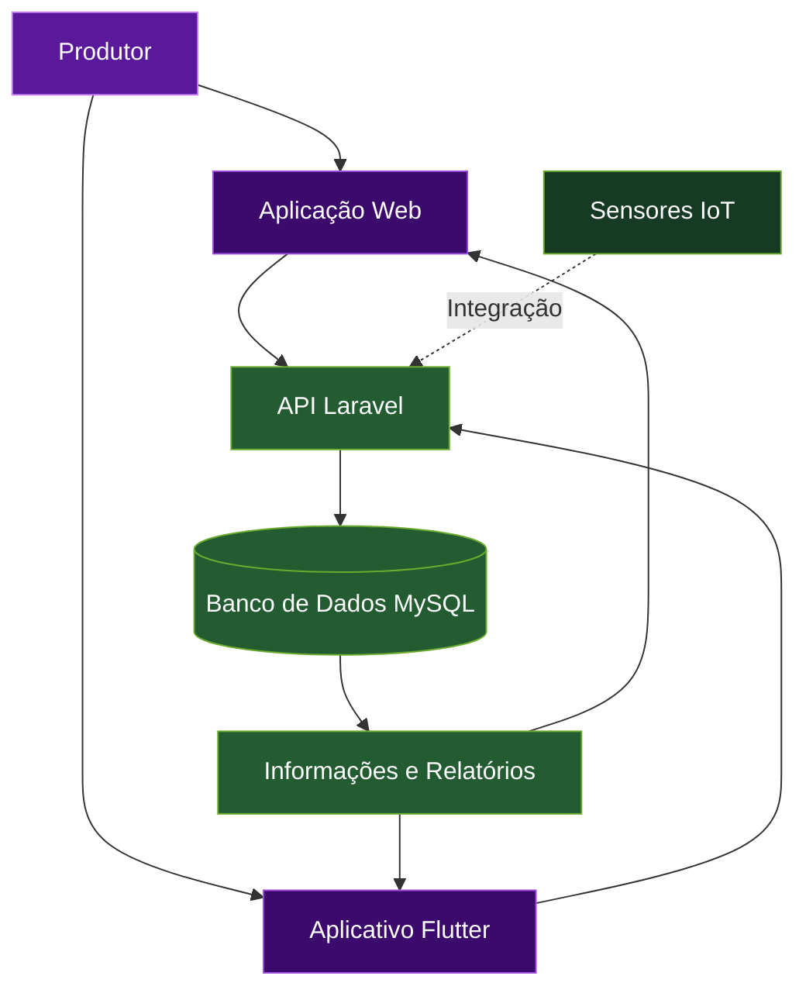

 

 

### ✨ Olá! Seja bem-vindo(a) ao meu universo de tecnologia.

**Transformando ideias em soluções digitais.**

 

---

## 💜 01 — SOBRE MIM

Olá! Sou **Bruna Figueira Silva**, estudante de Desenvolvimento de Sistemas, apaixonada por tecnologia, inovação e desenvolvimento de soluções digitais.

Gosto de transformar ideias em projetos funcionais, aprender novas ferramentas e explorar como diferentes tecnologias podem trabalhar juntas para resolver problemas do cotidiano.

Atualmente, meu foco está no desenvolvimento de aplicações web e mobile, integração de APIs, bancos de dados e projetos que conectam software e hardware.

<table>
<tr>
<td width="50%" valign="top">

### 🎯 O que me motiva

- Criar aplicações úteis e funcionais.
- Aprender desenvolvendo projetos reais.
- Resolver problemas por meio da tecnologia.
- Explorar novas ferramentas e possibilidades.
- Evoluir continuamente como desenvolvedora.

</td>
<td width="50%" valign="top">

### 🚀 Onde quero chegar

- Aprofundar meus conhecimentos técnicos.
- Desenvolver sistemas completos e organizados.
- Aprimorar minhas habilidades em back-end e mobile.
- Trabalhar em projetos colaborativos.
- Construir uma carreira sólida em tecnologia.

</td>
</tr>
</table>

---

## 🛠️ 02 — TECNOLOGIAS E FERRAMENTAS

*Ferramentas que fazem parte dos meus estudos e projetos.*

 

  

| Categoria | Tecnologias |
|---|---|
| Front-end | HTML5, CSS3 e JavaScript |
| Back-end | PHP e Laravel |
| Mobile | Flutter e Dart |
| Banco de dados | MySQL |
| Versionamento | Git e GitHub |
| IoT e hardware | ESP32 e sensores, conforme o projeto |

---

## 🌾 03 — PROJETO EM DESTAQUE

 

### Tecnologia, dados e automação para a gestão agropecuária.

O **AgriFarm** é um projeto de gerenciamento inteligente de ração em fazendas, desenvolvido com a proposta de integrar informações da propriedade em um único sistema e facilitar o acompanhamento da alimentação animal.

A solução conecta a gestão de fazendas, lotes, rações, cochos e estoque, utilizando tecnologias de desenvolvimento web e mobile e explorando a integração com sensores IoT.

### 🌱 O problema

O gerenciamento da alimentação em uma fazenda envolve diferentes informações, como quantidade de animais, consumo, disponibilidade de ração, estoque e organização dos lotes.

Quando esses dados não estão bem integrados, o acompanhamento pode se tornar mais trabalhoso, dificultando a identificação de desperdícios e a tomada de decisões.

### 💡 A proposta da solução

O AgriFarm busca centralizar essas informações em um sistema integrado, permitindo que o produtor acompanhe os dados de maneira organizada e tenha mais visibilidade sobre os recursos utilizados na propriedade.

### ⚙️ Principais funcionalidades

<table>
<tr>
<td width="50%" valign="top">

#### 🏡 Gestão de fazendas

- Cadastro e organização das propriedades.
- Associação de informações aos respectivos ambientes.
- Consulta dos dados de cada fazenda.

#### 🐄 Gestão de lotes

- Cadastro e acompanhamento de lotes.
- Organização por tipo de animal.
- Controle da quantidade de animais.
- Registro de informações relevantes para a gestão.

#### 🌾 Gestão alimentar

- Cadastro de rações.
- Organização de planos alimentares.
- Associação de rações aos lotes compatíveis.
- Consulta das informações de alimentação.

</td>
<td width="50%" valign="top">

#### 🥣 Gestão de cochos

- Organização dos cochos associados à operação.
- Acompanhamento das informações de capacidade.
- Consulta dos níveis e quantidades registrados.
- Possibilidade de integração com sensores.

#### 📦 Controle de estoque

- Consulta da disponibilidade de ração.
- Acompanhamento de movimentações.
- Organização das quantidades armazenadas.
- Apoio ao planejamento de reposição.

#### 📊 Dados e relatórios

- Consulta de indicadores do sistema.
- Visualização das informações da propriedade.
- Acompanhamento de dados operacionais.
- Apoio à análise e à tomada de decisões.

</td>
</tr>
</table>

### 🔌 Tecnologias e arquitetura

| Componente | Responsabilidade |
|---|---|
| Laravel / PHP | Regras de negócio, aplicação web e endpoints da API |
| Flutter / Dart | Interface e funcionalidades do aplicativo mobile |
| MySQL | Armazenamento e relacionamento dos dados |
| API REST | Comunicação entre clientes e servidor |
| IoT | Integração com sensores e dispositivos, conforme a implementação |

### 🔄 Fluxo conceitual do sistema

*O diagrama representa a arquitetura proposta. A comunicação real com sensores depende dos módulos implementados e configurados no sistema.*

### 🎯 Objetivos do AgriFarm

- Reduzir desperdícios na alimentação animal.
- Facilitar o acompanhamento das informações da fazenda.
- Organizar dados de lotes, rações, cochos e estoque.
- Melhorar a visibilidade sobre consumo e disponibilidade.
- Explorar automação e monitoramento com IoT.
- Apoiar decisões baseadas em dados.

---

## 💻 04 — OUTROS PROJETOS

*Outras experiências e aplicações desenvolvidas ao longo da minha jornada.*

<table>
<tr>
<td width="50%" valign="top">

### ✂️ Site Natalia Berretta

Projeto de site para profissional de beleza, com foco em apresentação de serviços e facilidade de agendamento pelo celular.

**Destaques**
- Layout responsivo.
- Apresentação de serviços.
- Experiência voltada ao agendamento.

**Tecnologias:** HTML, CSS e JavaScript.

[Ver repositório](https://github.com/SEU-USUARIO/SEU-REPOSITORIO)

</td>
<td width="50%" valign="top">

### ✨ Studio Monica Monique

Conceito de site para serviços de estética, com foco em uma apresentação elegante e experiência de agendamento online.

**Destaques**
- Design voltado ao público de beleza.
- Apresentação de procedimentos.
- Organização de informações e horários.

**Tecnologias:** HTML, CSS e JavaScript.

[Ver repositório](https://github.com/SEU-USUARIO/SEU-REPOSITORIO)

</td>
</tr>
</table>

Atualize os nomes e links para corresponder aos seus repositórios reais. Inclua apenas projetos que você possa apresentar publicamente.

---

## 📊 05 — MEU GITHUB EM NÚMEROS

*Um resumo da minha atividade pública na plataforma.*

 

  

Os cards são gerados por serviços externos. As linguagens refletem o código detectado nos repositórios públicos e não necessariamente o nível de domínio de cada tecnologia.

---

## 🎯 06 — MEUS OBJETIVOS

<table>
<tr>
<td align="center" width="33%">

### 📚 Aprender

Aprofundar conhecimentos em desenvolvimento, arquitetura de sistemas e boas práticas de programação.

</td>
<td align="center" width="33%">

### 🧩 Construir

Desenvolver aplicações úteis, organizadas, acessíveis e com boa experiência de uso.

</td>
<td align="center" width="33%">

### 🤝 Evoluir

Participar de projetos colaborativos, compartilhar conhecimento e crescer profissionalmente.

</td>
</tr>
</table>

---

## 💌 07 — VAMOS NOS CONECTAR?

Estou aberta a conhecer projetos, trocar experiências e aprender com outras pessoas da área de tecnologia.

 

  

**“Grandes ideias ganham força quando saem do papel.”**

 

<!-- PERSONALIZAÇÃO
1. Substitua SEU-USUARIO em todos os links pelo seu usuário do GitHub.
2. Atualize SEU-LINKEDIN, SEU-PORTFOLIO e SEU-EMAIL.
3. Troque SEU-REPOSITORIO-AGRIFARM pelo nome real do repositório.
4. Coloque a logo em assets/agrifarm-logo.png ou ajuste o caminho da imagem.
5. Atualize os links dos outros projetos.
6. Revise as funcionalidades e tecnologias do AgriFarm para refletir o que já está implementado.
-->
