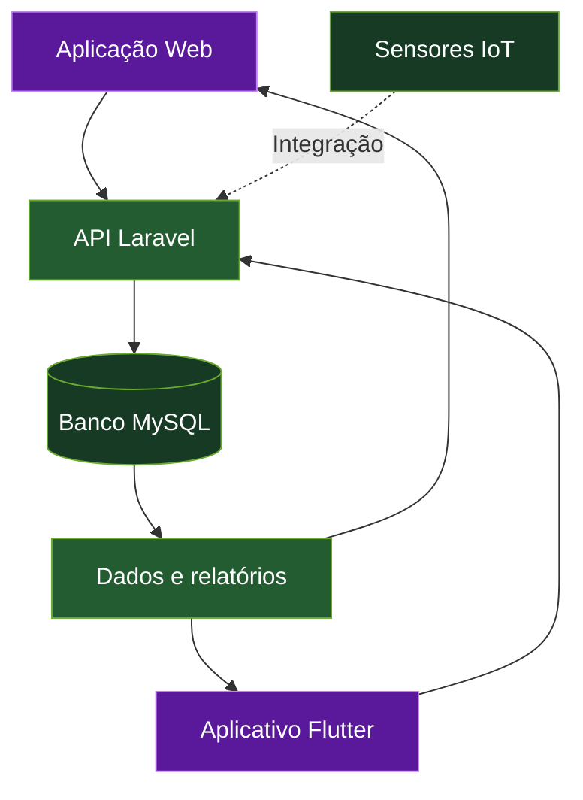

 

### Desenvolvedora em formação

**Transformando ideias em soluções digitais.**

---

## 01. Sobre mim

Olá! Sou **Bruna Figueira Silva**, estudante de Desenvolvimento de Sistemas, interessada em tecnologia, desenvolvimento de software e criação de soluções digitais.

Gosto de transformar ideias em aplicações funcionais, aprender novas ferramentas e desenvolver projetos que resolvam problemas reais. Tenho interesse em desenvolvimento web e mobile, APIs, bancos de dados e integração entre software e hardware.

- Desenvolvimento de aplicações web e mobile.
- Integração entre aplicações, APIs e bancos de dados.
- Aprendizado prático por meio de projetos.
- Interesse em automação, inovação e Internet das Coisas.
- Busca contínua por evolução técnica e profissional.

## 02. Tecnologias e ferramentas

  

| Categoria | Tecnologias |
|:---:|:---|
| Front-end | HTML5, CSS3 e JavaScript |
| Back-end | PHP e Laravel |
| Mobile | Flutter e Dart |
| Banco de dados | MySQL |
| Versionamento | Git e GitHub |
| IoT e hardware | ESP32 e sensores, conforme o projeto |

## 03. Projeto em destaque — AgriFarm

 

### Tecnologia, dados e automação para a gestão agropecuária

O **AgriFarm** é um projeto de gerenciamento inteligente de ração em fazendas, desenvolvido para centralizar informações da propriedade e facilitar o acompanhamento da alimentação animal.

A proposta é integrar a gestão de fazendas, lotes, rações, cochos e estoque em uma solução que ajude a organizar os dados operacionais e apoie decisões mais eficientes na rotina agropecuária.

### O problema

O gerenciamento da alimentação animal exige acompanhar diferentes informações, como quantidade de animais, rações disponíveis, consumo, capacidade dos cochos e movimentações de estoque. Quando esses dados estão dispersos, o controle pode ficar mais trabalhoso e dificultar a identificação de desperdícios.

### A solução

O AgriFarm reúne essas informações em um sistema integrado, com aplicação web, aplicativo mobile, banco de dados e possibilidade de integração com dispositivos IoT.

### Principais funcionalidades

<table>
<tr>
<td width="50%" valign="top">

#### Gestão de fazendas e lotes

- Organização das propriedades.
- Cadastro e acompanhamento de lotes.
- Controle da quantidade de animais.
- Consulta das informações por fazenda.

#### Gestão alimentar

- Cadastro de rações.
- Organização dos planos alimentares.
- Associação de rações compatíveis aos lotes.
- Consulta de dados relacionados à alimentação.

#### Controle de cochos

- Organização dos cochos.
- Acompanhamento da capacidade e das quantidades.
- Monitoramento de níveis, conforme os dados disponíveis.
- Possibilidade de integração com sensores.

</td>
<td width="50%" valign="top">

#### Controle de estoque

- Consulta da disponibilidade de ração.
- Registro de movimentações.
- Acompanhamento das quantidades armazenadas.
- Apoio ao planejamento de reposição.

#### Relatórios e indicadores

- Consulta de informações operacionais.
- Acompanhamento dos dados da propriedade.
- Visualização de informações por lote.
- Apoio à análise e à tomada de decisões.

#### Integração tecnológica

- Aplicação web e API.
- Aplicativo Flutter.
- Persistência de dados em MySQL.
- Integração com sensores IoT conforme os módulos implementados.

</td>
</tr>
</table>

### Tecnologias e arquitetura

<table>
<tr>
<td width="45%" valign="top">

#### Tecnologias utilizadas

| Tecnologia | Função |
|---|---|
| Laravel / PHP | Aplicação web e regras de negócio |
| API REST | Comunicação entre aplicações |
| Flutter / Dart | Aplicativo mobile |
| MySQL | Armazenamento dos dados |
| ESP32 / IoT | Integração com hardware, conforme a implementação |

#### Objetivos do projeto

- Organizar as informações da fazenda.
- Facilitar o acompanhamento do estoque e dos cochos.
- Apoiar o controle alimentar dos lotes.
- Explorar o monitoramento automatizado.
- Contribuir para a redução de desperdícios.

</td>
<td width="55%" valign="top">

#### Fluxograma da arquitetura

</td>
</tr>
</table>

## 04. Outros projetos

<table>
<tr>
<td width="50%" valign="top">

### Site Natalia Berretta

Projeto de site para profissional de beleza, com apresentação de serviços e foco na experiência de agendamento pelo celular.

**Destaques**
- Interface responsiva.
- Apresentação de serviços.
- Navegação simplificada.

**Tecnologias:** HTML, CSS e JavaScript.

[Ver repositório](https://github.com/SEU-USUARIO/SEU-REPOSITORIO)

</td>
<td width="50%" valign="top">

### Studio Monica Monique

Projeto de site para serviços de estética, com apresentação profissional e foco no agendamento online.

**Destaques**
- Layout adaptado para dispositivos móveis.
- Apresentação de procedimentos.
- Organização de informações e horários.

**Tecnologias:** HTML, CSS e JavaScript.

[Ver repositório](https://github.com/SEU-USUARIO/SEU-REPOSITORIO)

</td>
</tr>
</table>

*Atualize os links e as descrições para refletir os projetos publicados e suas funcionalidades reais.*

## 05. Estatísticas do GitHub

  

Os cards dependem de serviços externos e podem ficar temporariamente indisponíveis. As linguagens exibidas refletem o código detectado nos repositórios públicos.

## 06. Objetivos profissionais

<table>
<tr>
<td width="33%" align="center" valign="top">

### Aprender

Aprofundar conhecimentos em desenvolvimento, arquitetura de sistemas e boas práticas de programação.

</td>
<td width="33%" align="center" valign="top">

### Construir

Desenvolver aplicações funcionais, acessíveis, organizadas e fáceis de utilizar.

</td>
<td width="33%" align="center" valign="top">

### Evoluir

Participar de projetos colaborativos, ampliar a experiência prática e crescer profissionalmente.

</td>
</tr>
</table>

## 07. Contato

Estou aberta a conhecer projetos, trocar experiências e aprender com outras pessoas da área de tecnologia.

 

  

**Construindo, aprendendo e evoluindo um projeto de cada vez.**

<!--
ANTES DE PUBLICAR:
1. Substitua SEU-USUARIO pelo seu nome de usuário real em todos os links.
2. Atualize SEU-LINKEDIN, SEU-PORTFOLIO e SEU-EMAIL.
3. Coloque a logo original em assets/agrifarm-logo.png.
4. Atualize os links dos repositórios do AgriFarm e dos outros projetos.
5. Mantenha apenas as tecnologias e funcionalidades que correspondem à sua experiência e ao estado real dos projetos.
-->
