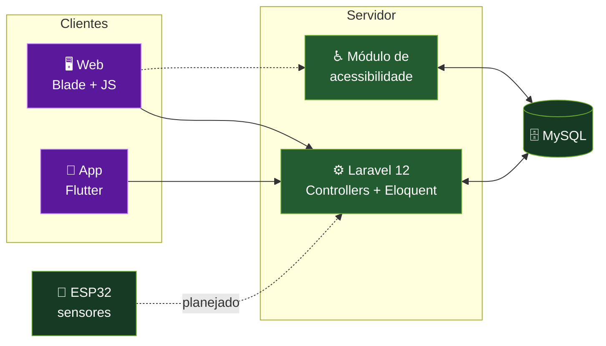

<div align="center">


<a href="https://github.com/SEU-USUARIO">

</a>

<br/>

<a href="https://github.com/SEU-USUARIO"></a>
<a href="https://www.linkedin.com/in/SEU-LINKEDIN/"></a>
<a href="SEU-PORTFOLIO"></a>
<a href="mailto:SEU-EMAIL"></a>


</div>


## 👩‍💻 Sobre mim


Sou **Bruna Figueira Silva**, estudante de Desenvolvimento de Sistemas. Gosto de pegar um problema concreto e levar até uma aplicação que funciona de ponta a ponta: banco de dados, back-end, interface web, app mobile e, quando faz sentido, hardware.

Meu projeto principal é o **AgriFarm**, uma plataforma de gestão de ração para fazendas, onde trabalhei desde a modelagem do banco até um sistema de acessibilidade completo seguindo a WCAG 2.2.

```js
const bruna = {
  foco:       ["Desenvolvimento web", "Mobile", "APIs", "Banco de dados"],
  estudando:  ["Arquitetura com Laravel", "Flutter", "IoT com ESP32"],
  interesses: ["Acessibilidade digital", "Agricultura 4.0", "Automação"],
  buscando:   "Estágio ou primeira oportunidade na área de desenvolvimento",
};
```

## 🧰 Tecnologias

<div align="center">


</div>

| Área | Tecnologias |
|:---|:---|
| **Back-end** | PHP 8+, Laravel 12, Eloquent, Blade |
| **Front-end** | HTML5, CSS3, JavaScript ES6+, Chart.js |
| **Mobile** | Flutter, Dart |
| **Banco de dados** | MySQL |
| **IoT** | ESP32, sensores |
| **Ferramentas** | Git, GitHub, VS Code |


## 🌱 Projeto em destaque — AgriFarm

<div align="center">


</div>

**O problema.** Na rotina da fazenda, as informações sobre alimentação animal ficam espalhadas: quantos animais há em cada lote, qual ração eles recebem, quanto cabe em cada cocho e quanto resta em estoque. Sem esses dados juntos, é difícil perceber desperdício ou planejar a reposição a tempo.

**A solução.** O AgriFarm centraliza fazendas, lotes, animais, rações, cochos, estoque, planos alimentares e relatórios em um único sistema, com dashboard por fazenda, app mobile e espaço para integração com sensores.

### O que já está implementado

<table>
<tr>
<td width="50%" valign="top">

**📊 Dashboard por fazenda**
Ao selecionar uma propriedade, os cards e gráficos (Chart.js) mostram os dados reais dela, vindos do banco: lotes novos na semana, variação de consumo em relação ao dia anterior, custo estimado da ração e status do estoque. Todos os cálculos ficam no back-end.

**🗂️ Gestão completa (CRUD)**
Fazendas, lotes, cochos, rações, estoques, planos alimentares e relatórios, com 9 Models Eloquent relacionados entre si e rotas nomeadas.

</td>
<td width="50%" valign="top">

**♿ Acessibilidade digital (WCAG 2.2)**
Um único componente reutilizado em todas as telas, com:
- temas claro, escuro e alto contraste (nível AAA);
- ajuste de tamanho de fonte e zoom;
- leitura em voz alta com a Web Speech API;
- integração com o VLibras (Libras);
- ARIA completo (`role="dialog"`, `aria-expanded`, `aria-live`);
- preferências salvas no MySQL por usuário, sincronizadas entre dispositivos.

</td>
</tr>
</table>

### Arquitetura



<details>
<summary><b>📁 Modelo de dados (clique para ver)</b></summary>

<br/>

| Tabela | Responsabilidade |
|:---|:---|
| `cadastros` | Usuários e autenticação |
| `fazendas` | Propriedades de cada usuário |
| `lotes` | Grupos de animais por fazenda |
| `animals` | Animais vinculados aos lotes |
| `cochos` | Capacidade e nível de cada cocho |
| `racaos` | Tipos de ração |
| `estoques` | Quantidades e movimentações |
| `planos` | Planos alimentares e consumo |
| `relatorios` | Relatórios gerados |
| `acessibilidade_preferencias` | Preferências de acessibilidade por usuário |

</details>

<div align="center">

<a href="https://github.com/SEU-USUARIO/SEU-REPOSITORIO-AGRIFARM"></a>

</div>


## 📈 Estatísticas

<div align="center">


</div>

## 🎯 Próximos passos

- [x] Sistema de acessibilidade unificado no AgriFarm
- [x] Dashboard integrado ao banco de dados
- [ ] Integração do ESP32 com o nível dos cochos
- [ ] Publicar a API documentada para o app Flutter
- [ ] Testes automatizados (PHPUnit)

<div align="center">

### 📬 Vamos conversar?


<a href="https://www.linkedin.com/in/SEU-LINKEDIN/"></a>
<a href="mailto:SEU-EMAIL"></a>

<br/>

*Construindo, aprendendo e evoluindo, um projeto de cada vez.*


</div>

<!--
CHECKLIST ANTES DE PUBLICAR
1. Substitua SEU-USUARIO, SEU-LINKEDIN, SEU-PORTFOLIO e SEU-EMAIL (Ctrl+H no VS Code).
2. Coloque a logo em assets/agrifarm-logo.png (o repositório do perfil precisa ter o mesmo nome do seu usuário).
3. Atualize o link do repositório do AgriFarm.
4. Ajuste o checklist de "Próximos passos" conforme o andamento real.
5. Se os cards de estatísticas ficarem fora do ar, faça deploy próprio do github-readme-stats na Vercel
   (instruções no repositório anuraghazra/github-readme-stats) e troque a URL base.
-->
