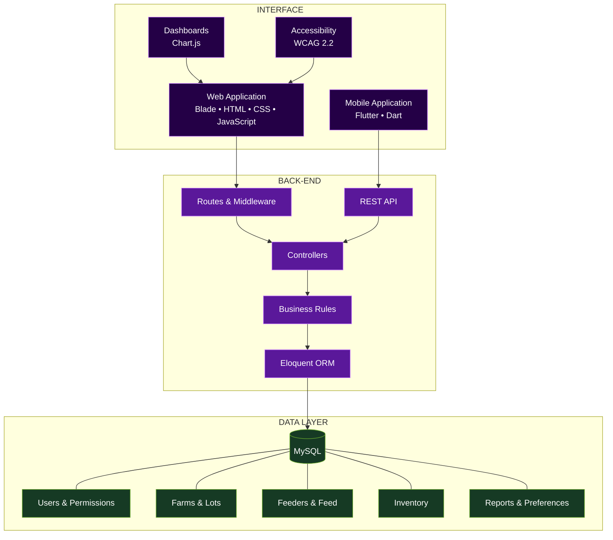

# 👩🏻‍💻 Bruna Figueira Silva

 

 

---

## 👋 Sobre mim

Sou desenvolvedora de sistemas, com formação em **Desenvolvimento de Sistemas** e interesse em desenvolvimento Web, Mobile e engenharia de software.

Tenho experiência prática no desenvolvimento de aplicações completas, trabalhando desde a modelagem de bancos de dados e implementação de regras de negócio até a construção de interfaces responsivas, integrações e recursos de acessibilidade.

Busco desenvolver soluções que unam **funcionalidade, organização, desempenho e uma boa experiência para o usuário**, utilizando tecnologias modernas e boas práticas de programação.

- 💻 Desenvolvimento de aplicações Web e Mobile.
- ⚙️ Construção de APIs, sistemas CRUD e regras de negócio.
- 🗄️ Modelagem e gerenciamento de bancos de dados relacionais.
- 📱 Desenvolvimento de interfaces com Flutter.
- ♿ Implementação de recursos de acessibilidade.
- 🚀 Interesse contínuo em arquitetura, inovação e evolução tecnológica.

---

## 🛠️ Tecnologias e ferramentas

### Back-end

### Front-end

### Mobile

### Desenvolvimento e versionamento

 

| Categoria | Tecnologias |
|---|---|
| **Back-end** | PHP 8+, Laravel 12, MVC, APIs REST |
| **Banco de dados** | MySQL, SQL, modelagem relacional |
| **Front-end** | HTML5, CSS3, JavaScript ES6+, Blade |
| **Mobile** | Flutter, Dart |
| **Visualização de dados** | Chart.js, dashboards, gráficos dinâmicos |
| **Acessibilidade** | WCAG 2.2, ARIA, contraste, navegação acessível |
| **Versionamento** | Git, GitHub |
| **Ferramentas** | VS Code, XAMPP |

---

# 🚀 Projetos

## 🌱 AgriFarm — Gerenciamento Inteligente de Ração em Fazendas

### Sobre o projeto

O AgriFarm é uma plataforma de gerenciamento inteligente voltada à administração de propriedades rurais, desenvolvida para centralizar informações e otimizar o controle da alimentação animal.

O sistema integra gerenciamento de fazendas, lotes, cochos, rações, estoque, planos alimentares e indicadores operacionais, utilizando tecnologia e análise de dados para auxiliar produtores rurais na tomada de decisões.

### Principais funcionalidades

<table>
<tr>
<td width="50%" valign="top">

#### 📊 Dashboard inteligente
- Indicadores operacionais em tempo real.
- Visualização de consumo e estoque.
- Gráficos de desempenho.
- Resumo das atividades da propriedade.

#### 🐄 Gerenciamento de lotes
- Cadastro e controle de lotes.
- Espécie e quantidade de animais.
- Peso médio e acompanhamento.
- Histórico de movimentações.

</td>
<td width="50%" valign="top">

#### 🌾 Gestão alimentar
- Cadastro de rações.
- Planos alimentares.
- Controle de consumo.
- Compatibilidade entre alimentação e lote.

#### 📦 Controle de estoque
- Movimentações de entrada e saída.
- Monitoramento de disponibilidade.
- Alertas de estoque baixo.
- Histórico de movimentações.

</td>
</tr>
</table>

### ♿ Acessibilidade

O AgriFarm foi desenvolvido considerando princípios de acessibilidade e inclusão digital, oferecendo:

- Interface com suporte a temas claro e escuro.
- Modo de alto contraste.
- Ajuste de tamanho de fonte e zoom.
- Leitura de conteúdo em voz alta.
- Recursos de navegação acessível.
- Compatibilidade com tecnologias assistivas.
- Preferências de acessibilidade personalizadas.

### 🏗️ Arquitetura

### Tecnologias utilizadas

| Tecnologia | Aplicação |
|---|---|
| PHP 8+ | Lógica de negócio |
| Laravel 12 | Framework back-end |
| MySQL | Persistência e relacionamento de dados |
| Eloquent ORM | Manipulação de entidades |
| Blade | Templates da aplicação Web |
| JavaScript | Interatividade e atualização de interfaces |
| Chart.js | Gráficos e indicadores |
| Flutter | Aplicação Mobile |
| Dart | Desenvolvimento Mobile |
| IoT | Monitoramento e coleta de dados de sensores |

### Objetivos do projeto

- Reduzir desperdícios de alimentação.
- Melhorar o controle de estoque.
- Centralizar informações da propriedade rural.
- Facilitar o acompanhamento dos lotes.
- Apoiar decisões baseadas em dados.
- Integrar tecnologia à gestão rural.
- Promover eficiência e sustentabilidade.

---

## 💡 Outros projetos

> Espaço destinado à apresentação de outros sistemas, aplicações e projetos desenvolvidos durante minha trajetória profissional e acadêmica.

| Projeto | Descrição | Tecnologias |
|---|---|---|
| **Sistemas Web** | Aplicações com autenticação, CRUD, dashboards e gerenciamento de dados. | PHP, Laravel, MySQL |
| **Aplicações Mobile** | Interfaces mobile e integração com APIs. | Flutter, Dart |
| **Sistemas de Gestão** | Soluções com regras de negócio, banco de dados e relatórios. | PHP, SQL, JavaScript |

---

# 📈 GitHub

 

---

# 🎯 Objetivos profissionais

- Atuar como desenvolvedora Web, Back-end, Full Stack ou Mobile.
- Participar do desenvolvimento de aplicações reais.
- Aprimorar conhecimentos em arquitetura de software.
- Evoluir em APIs REST e integração de sistemas.
- Desenvolver aplicações escaláveis e acessíveis.
- Colaborar com equipes de tecnologia.
- Aprender novas tecnologias e metodologias de desenvolvimento.

---

# 📬 Contato

Estou aberta a oportunidades profissionais, projetos colaborativos e conexões na área de tecnologia.

 

---

Desenvolvido com dedicação, criatividade e tecnologia por <strong>Bruna Figueira Silva</strong>.

