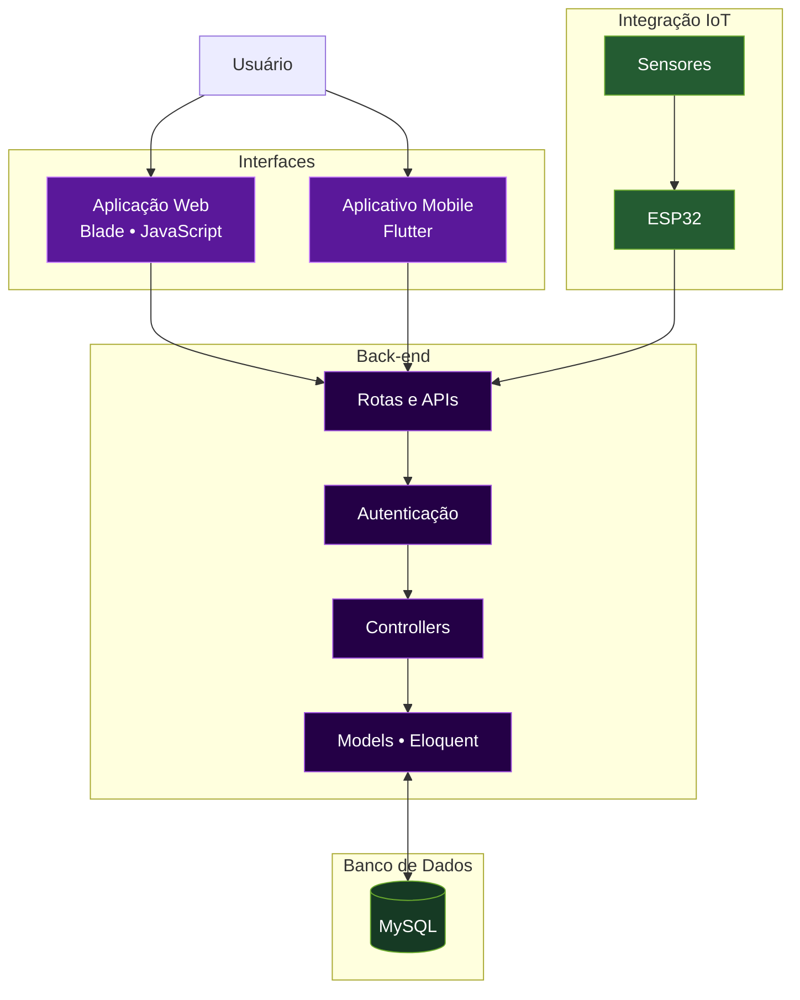

# Bruna Figueira Silva

### Desenvolvedora de Sistemas em formação

Desenvolvimento Web · Back-end · Mobile

 

---

## Sobre mim

Sou estudante de **Desenvolvimento de Sistemas**, com interesse em desenvolvimento de software, arquitetura de aplicações, banco de dados e tecnologia aplicada à resolução de problemas reais.

Tenho experiência acadêmica e prática no desenvolvimento de aplicações web e mobile, trabalhando desde a modelagem de dados e implementação de regras de negócio até a construção de interfaces e integração entre sistemas.

Atualmente, desenvolvo o **AgriFarm**, uma plataforma de gerenciamento inteligente de ração em fazendas, como projeto de conclusão de curso.

Busco minha primeira oportunidade profissional na área de tecnologia, especialmente em desenvolvimento de software, onde possa contribuir com meus conhecimentos, evoluir tecnicamente e aprender com uma equipe.

---

## Tecnologias e ferramentas

### Desenvolvimento Web

### Banco de dados

### Desenvolvimento Mobile

### Ferramentas

<table>
<tr>
<td width="50%" valign="top">

### Back-end

- PHP 8+
- Laravel 12
- Eloquent ORM
- Controllers e rotas
- APIs REST
- Autenticação
- Regras de negócio

</td>
<td width="50%" valign="top">

### Front-end

- HTML5
- CSS3
- JavaScript ES6+
- Blade
- Interfaces responsivas
- Chart.js

</td>
</tr>
<tr>
<td width="50%" valign="top">

### Banco de dados

- MySQL
- Modelagem relacional
- SQL
- Relacionamentos
- Integridade dos dados

</td>
<td width="50%" valign="top">

### Mobile e ferramentas

- Flutter
- Dart
- Git
- GitHub
- Visual Studio Code

</td>
</tr>
</table>

---

## Projetos

### AgriFarm — Gestão Inteligente de Ração em Fazendas

 

O **AgriFarm** é uma plataforma desenvolvida para centralizar e otimizar o gerenciamento de ração em propriedades rurais, integrando informações sobre fazendas, lotes, cochos, consumo e estoque.

O projeto busca transformar dados operacionais em informações úteis para auxiliar produtores na tomada de decisões, reduzir desperdícios e melhorar o controle alimentar.

#### Funcionalidades

- Dashboard com indicadores específicos por fazenda.
- Gerenciamento de fazendas e lotes.
- Controle de cochos e consumo de ração.
- Gerenciamento de rações e estoque.
- Planos alimentares.
- Relatórios de desempenho.
- Gráficos de consumo e indicadores.
- Integração com sensores IoT.
- Aplicação mobile com Flutter.
- Recursos de acessibilidade digital.

#### Diferenciais técnicos

| Área | Implementação |
|---|---|
| Arquitetura | MVC |
| Back-end | Laravel 12 |
| Persistência | MySQL |
| ORM | Eloquent |
| Interface web | Blade, HTML, CSS e JavaScript |
| Visualização de dados | Chart.js |
| Mobile | Flutter e Dart |
| IoT | ESP32 e sensores |
| Acessibilidade | WCAG, contraste, zoom e leitura em voz alta |

#### Arquitetura do sistema

#### Acessibilidade

O sistema também possui recursos voltados à acessibilidade digital:

- Modo claro e escuro.
- Alto contraste.
- Ajuste de tamanho de fonte.
- Controle de zoom.
- Leitura de conteúdo em voz alta.
- Integração com VLibras.
- Elementos semânticos e atributos ARIA.
- Persistência das preferências do usuário.

---

### Portfólio pessoal

Desenvolvi meu portfólio pessoal para apresentar minha trajetória, habilidades técnicas, projetos e experiências de desenvolvimento.

O site conta com uma apresentação interativa, animações, navegação entre seções e um estudo de caso detalhado do AgriFarm, incluindo uma simulação de sensores e visualização dinâmica de dados.

---

## GitHub

### Estatísticas

### Linguagens mais utilizadas

### Contribuições

---

## Objetivo profissional

Busco uma oportunidade de **estágio em Desenvolvimento de Sistemas**, com interesse em:

- Desenvolvimento Back-end.
- Desenvolvimento Full Stack.
- Desenvolvimento Web.
- Desenvolvimento Mobile.
- Banco de dados.
- Engenharia de software.

Tenho disposição para aprender, desenvolver novas habilidades, colaborar em equipe e participar de projetos que contribuam para meu crescimento profissional e para os resultados da empresa.

---

## Contato

Vamos conversar sobre tecnologia, projetos ou oportunidades profissionais?

 

  

