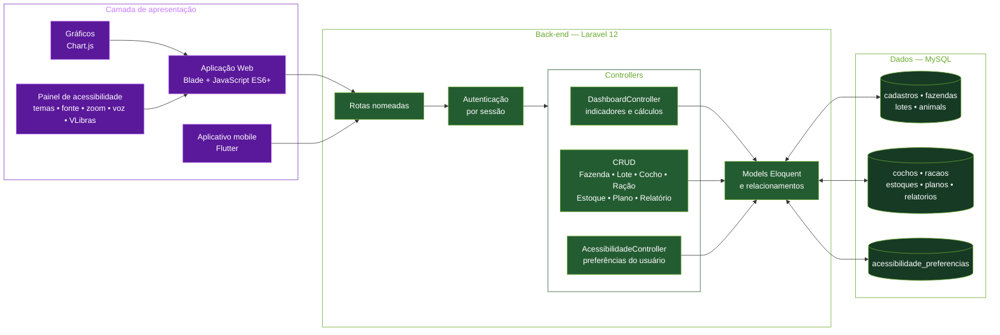

 

## Sobre mim

Sou **Bruna Figueira Silva**, estudante de Desenvolvimento de Sistemas. Trabalho com aplicações completas, do banco de dados à interface, com foco em back-end com Laravel, interfaces acessíveis e aplicativos mobile com Flutter.

Atualmente desenvolvo o **AgriFarm**, meu Trabalho de Conclusão de Curso, e busco uma oportunidade de estágio na área de desenvolvimento.

## Em busca de estágio

<table>
<tr>
<td width="50%" valign="top">

**O que procuro**
- Estágio em desenvolvimento de software.
- Atuação em back-end, front-end, full stack ou mobile.
- Um time onde eu possa aprender com revisões de código e boas práticas.

</td>
<td width="50%" valign="top">

**O que já pratiquei**
- Modelagem de banco de dados relacional em MySQL.
- CRUDs e regras de negócio com Laravel e Eloquent.
- Dashboards com dados reais e gráficos em Chart.js.
- Interfaces acessíveis seguindo a WCAG 2.2.

</td>
</tr>
</table>

## Tecnologias

| Área | Tecnologias |
|:---|:---|
| Back-end | PHP 8+, Laravel 12, Eloquent, Blade |
| Front-end | HTML5, CSS3, JavaScript ES6+, Chart.js |
| Mobile | Flutter, Dart |
| Banco de dados | MySQL |
| Versionamento | Git, GitHub |

## Portfólio Web

<table>
<tr>
<td width="100%" valign="top">

**Portfólio Pessoal & Simulação Interativa**  
Página desenvolvida em **HTML5, CSS3 e JavaScript** para apresentar minha trajetória, minha stack técnica e o estudo de caso detalhado do **AgriFarm** — incluindo uma simulação ao vivo da balança de ração integrada ao sensor de distância do animal e gráfico dinâmico.

 

</td>
</tr>
</table>

## Projeto em destaque

  
  &nbsp;&nbsp;
  

O **AgriFarm** é uma plataforma de gestão de ração para fazendas. Ela reúne em um único sistema as informações que costumam ficar espalhadas na rotina da propriedade: lotes, animais, rações, cochos, estoque e planos alimentares. Com os dados centralizados, fica mais fácil identificar desperdícios e planejar a reposição.

<table>
<tr>
<td width="50%" valign="top">

**Dashboard por fazenda**
Cards e gráficos que exibem os dados reais da fazenda selecionada: novos lotes na semana, variação de consumo, custo estimado de ração e situação do estoque. Os cálculos são feitos no back-end.

**Gestão completa**
Cadastro, consulta, edição e exclusão de fazendas, lotes, cochos, rações, estoques, planos alimentares e relatórios, com 9 Models Eloquent relacionados.

</td>
<td width="50%" valign="top">

**Acessibilidade digital**
Componente único, presente em todas as telas:
- temas claro, escuro e alto contraste (AAA);
- ajuste de fonte e zoom;
- leitura em voz alta;
- integração com o VLibras;
- atributos ARIA;
- preferências salvas por usuário no banco de dados.

</td>
</tr>
</table>

### Arquitetura

**Fluxo de uma requisição:** o usuário acessa a aplicação web ou o app; a rota passa pela verificação de sessão e chega ao controller; o controller consulta os Models Eloquent, faz os cálculos e devolve os dados prontos para a tela. As preferências de acessibilidade seguem o mesmo caminho e ficam salvas no banco para cada usuário.

## Contato

Procurando minha primeira oportunidade de estágio. Se você tem uma vaga ou quer conhecer melhor o AgriFarm, me chame.

