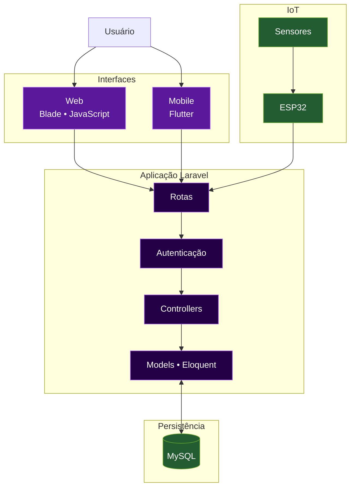

 

---

## Sobre mim

Sou **Bruna Figueira Silva**, Técnica em Desenvolvimento de Sistemas, com conhecimentos em desenvolvimento web, mobile, banco de dados e engenharia de software.

Tenho experiência prática no desenvolvimento de aplicações completas, trabalhando desde a modelagem de bancos de dados e implementação de regras de negócio até a construção de interfaces e integração entre sistemas.

Possuo conhecimentos em **PHP, Laravel, MySQL, JavaScript, Flutter e Dart**, além de interesse em acessibilidade digital, desenvolvimento de APIs e soluções tecnológicas inovadoras.

Desenvolvi o **AgriFarm**, uma plataforma de gerenciamento inteligente de ração em fazendas, como projeto de conclusão de curso, aplicando conhecimentos de desenvolvimento web, mobile, banco de dados e IoT.

Busco minha primeira oportunidade profissional na área de tecnologia, onde possa aplicar meus conhecimentos, contribuir com projetos reais e continuar evoluindo como desenvolvedora.

---

## Tecnologias

### Web Development

### Banco de Dados

### Mobile Development

### Ferramentas

<table>
<tr>
<td width="50%" valign="top">

### Back-end

- PHP 8+
- Laravel 12
- Eloquent ORM
- Controllers e rotas
- APIs REST
- Autenticação
- Regras de negócio

</td>

<td width="50%" valign="top">

### Front-end

- HTML5
- CSS3
- JavaScript ES6+
- Blade
- Interfaces responsivas
- Chart.js

</td>
</tr>

<tr>
<td width="50%" valign="top">

### Banco de dados

- MySQL
- Modelagem relacional
- SQL
- Relacionamentos
- Integridade de dados

</td>

<td width="50%" valign="top">

### Mobile e ferramentas

- Flutter
- Dart
- Git
- GitHub
- Visual Studio Code

</td>
</tr>
</table>

---

## Projetos

### AgriFarm

 

**Gerenciamento Inteligente de Ração em Fazendas**

O AgriFarm é uma plataforma desenvolvida para centralizar e otimizar o gerenciamento de ração em propriedades rurais, integrando informações sobre fazendas, lotes, cochos, consumo e estoque.

O sistema utiliza tecnologia para transformar dados operacionais em informações úteis para auxiliar produtores na tomada de decisões, reduzir desperdícios e melhorar o controle alimentar.

#### Funcionalidades

<table>
<tr>
<td width="50%" valign="top">

**Gestão**

- Cadastro de fazendas.
- Gerenciamento de lotes.
- Controle de cochos.
- Cadastro de rações.
- Controle de estoque.
- Planos alimentares.

</td>

<td width="50%" valign="top">

**Monitoramento**

- Dashboard por fazenda.
- Indicadores de consumo.
- Gráficos de desempenho.
- Relatórios gerenciais.
- Integração com sensores IoT.
- Aplicativo mobile.

</td>
</tr>
</table>

#### Arquitetura

#### Tecnologias utilizadas

| Tecnologia | Aplicação |
|---|---|
| Laravel 12 | Estrutura e back-end |
| PHP | Regras de negócio |
| MySQL | Persistência dos dados |
| Eloquent ORM | Relacionamento e consultas |
| Blade | Interface web |
| JavaScript | Interatividade |
| Chart.js | Gráficos e indicadores |
| Flutter | Aplicativo mobile |
| ESP32 | Integração IoT |

#### Acessibilidade digital

O sistema conta com recursos de acessibilidade para proporcionar uma experiência mais inclusiva:

- Modo claro e escuro.
- Alto contraste.
- Ajuste de fonte.
- Controle de zoom.
- Leitura em voz alta.
- Integração com VLibras.
- Atributos ARIA.
- Preferências persistidas no banco de dados.

---

### Portfólio pessoal

Desenvolvi meu portfólio para apresentar minha trajetória profissional, habilidades técnicas e projetos.

O site possui uma apresentação interativa, animações, navegação dinâmica e um estudo de caso detalhado do AgriFarm, incluindo simulação de sensores e visualização de dados.

---

## GitHub Analytics

### Estatísticas gerais

 

### Linguagens mais utilizadas

 

### Histórico de contribuições

---

## Objetivo profissional

Técnica em Desenvolvimento de Sistemas, em busca da minha primeira oportunidade profissional na área de tecnologia.

Tenho interesse em oportunidades de:

- Desenvolvimento Back-end.
- Desenvolvimento Full Stack.
- Desenvolvimento Web.
- Desenvolvimento Mobile.
- Engenharia de Software.

Busco integrar uma equipe onde possa aplicar meus conhecimentos, participar de projetos, colaborar com outros profissionais e ampliar minha experiência prática.

---

## Contato

Estou aberta a oportunidades, networking e projetos relacionados à tecnologia.

 

  

